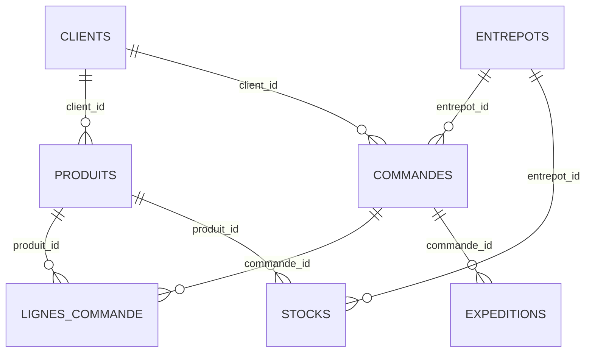

# Modèle de données — DATA CORE

## 1. Objectif

Ce document décrit le modèle relationnel actuellement déployé dans PostgreSQL pour le projet DATA CORE. Il distingue les données opérationnelles FluxPro, les commandes clients consolidées, l'historique des expéditions et les données IoT.

## 2. Périmètre du modèle

Le schéma PostgreSQL comprend les tables suivantes :

### 2.1 Données opérationnelles FluxPro

- `clients`
- `entrepots`
- `produits`
- `commandes`
- `lignes_commande`
- `expeditions`
- `stocks`

### 2.2 Données clients consolidées

- `clients_consolides`

Cette table rassemble les commandes issues des fichiers hétérogènes des clients.

### 2.3 Données historiques

- `historique_expeditions`

Cette table contient l'historique des expéditions importé depuis le fichier historique.

### 2.4 Données IoT

- `iot_camera_comptage`
- `iot_capteurs_temperature`
- `iot_geoloc_flotte`
- `iot_rfid_scans`

Ces tables stockent les comptages, les mesures de température, les positions de véhicules et les scans RFID.

## 3. Entités et attributs

### 3.1 Clients

**Table :** `clients`

- `id` : clé primaire, entier
- `code` : code du client, obligatoire
- `nom` : nom du client, obligatoire
- `secteur` : secteur d'activité, facultatif

### 3.2 Entrepôts

**Table :** `entrepots`

- `id` : clé primaire, entier
- `code` : code de l'entrepôt, obligatoire
- `nom` : nom de l'entrepôt, obligatoire
- `ville` : ville, obligatoire
- `capacite_palettes` : capacité en palettes, facultative

### 3.3 Produits

**Table :** `produits`

- `id` : clé primaire, entier
- `sku` : référence produit, obligatoire
- `libelle` : libellé du produit, obligatoire
- `client_id` : référence facultative vers `clients.id`
- `categorie` : catégorie, facultative
- `poids_kg` : poids en kilogrammes, facultatif
- `temperature_dirigee` : indicateur booléen, facultatif

### 3.4 Commandes

**Table :** `commandes`

- `id` : clé primaire, entier
- `client_id` : référence facultative vers `clients.id`
- `entrepot_id` : référence facultative vers `entrepots.id`
- `date_commande` : date de commande, facultative
- `statut` : statut de la commande, facultatif

### 3.5 Lignes de commande

**Table :** `lignes_commande`

- `id` : clé primaire, entier
- `commande_id` : référence facultative vers `commandes.id`
- `produit_id` : référence facultative vers `produits.id`
- `quantite` : quantité commandée, facultative

### 3.6 Expéditions

**Table :** `expeditions`

- `id` : clé primaire, entier
- `commande_id` : référence facultative vers `commandes.id`
- `tracking_number` : numéro de suivi, obligatoire
- `transporteur` : transporteur, facultatif
- `date_expedition` : date d'expédition, facultative
- `date_livraison_prevue` : date prévue, facultative
- `date_livraison_reelle` : date réelle, facultative
- `statut` : statut de l'expédition, facultatif

### 3.7 Stocks

**Table :** `stocks`

- `id` : clé primaire, entier
- `entrepot_id` : référence facultative vers `entrepots.id`
- `produit_id` : référence facultative vers `produits.id`
- `quantite` : quantité en stock, facultative
- `date_maj` : date de mise à jour, facultative

### 3.8 Commandes clients consolidées

**Table :** `clients_consolides`

- `id` : clé primaire, entier long
- `source` : source cliente, obligatoire
- `reference_commande` : référence de commande, obligatoire
- `date_commande` : date de commande, obligatoire
- `reference_produit` : référence du produit, obligatoire
- `designation_produit` : désignation, obligatoire
- `quantite` : quantité, facultative
- `entrepot_destination` : entrepôt de destination, obligatoire
- `poids_unitaire_g` : poids unitaire en grammes, facultatif
- `chaine_froid_requise` : indicateur textuel, facultatif

### 3.9 Historique des expéditions

**Table :** `historique_expeditions`

- `id` : clé primaire, entier long
- `client` : client, obligatoire
- `entrepot` : entrepôt, obligatoire
- `categorie_produit` : catégorie de produit, obligatoire
- `date_expedition` : date d'expédition, obligatoire
- `poids_kg` : poids en kilogrammes, obligatoire
- `delai_livraison_jours` : délai de livraison en jours, obligatoire
- `cout_transport_eur` : coût de transport en euros, obligatoire
- `statut` : statut, obligatoire

### 3.10 Données IoT

**`iot_camera_comptage`**
- `id` : clé primaire
- `timestamp` : date et heure de mesure
- `entrepot` : entrepôt
- `zone` : zone de comptage
- `nb_passages` : nombre de passages
- `sens` : entrée ou sortie

**`iot_capteurs_temperature`**
- `id` : clé primaire
- `timestamp` : date et heure de mesure
- `entrepot` : entrepôt
- `zone` : zone mesurée
- `temperature_c` : température en degrés Celsius
- `alerte` : indicateur numérique d'alerte

**`iot_geoloc_flotte`**
- `id` : clé primaire
- `timestamp` : date et heure de mesure
- `vehicule_id` : identifiant du véhicule
- `lat` : latitude
- `lon` : longitude
- `vitesse_kmh` : vitesse en kilomètres par heure

**`iot_rfid_scans`**
- `scan_id` : clé primaire
- `timestamp` : date et heure du scan
- `palette_id` : identifiant de palette
- `entrepot` : entrepôt
- `zone` : zone du scan
- `produit_sku` : référence produit

## 4. Relations déclarées dans PostgreSQL

Les clés étrangères actuellement déclarées sont :

| Table source | Colonne | Table cible | Colonne cible |
|---|---|---|---|
| `produits` | `client_id` | `clients` | `id` |
| `commandes` | `client_id` | `clients` | `id` |
| `commandes` | `entrepot_id` | `entrepots` | `id` |
| `lignes_commande` | `commande_id` | `commandes` | `id` |
| `lignes_commande` | `produit_id` | `produits` | `id` |
| `expeditions` | `commande_id` | `commandes` | `id` |
| `stocks` | `entrepot_id` | `entrepots` | `id` |
| `stocks` | `produit_id` | `produits` | `id` |

Les cardinalités métier ne sont pas toutes imposées par les contraintes SQL. Elles devront être précisées et validées avec les règles métier.

## 5. Séparation des domaines de données

Les tables historiques et IoT ne déclarent pas de clés étrangères vers les tables opérationnelles FluxPro. Leurs champs textuels décrivant les clients, entrepôts, véhicules, zones ou produits ne doivent donc pas être interprétés comme des relations SQL garanties.

La table `clients_consolides` constitue également une structure distincte : ses colonnes de référence ne sont pas reliées par des clés étrangères aux tables `clients`, `produits` ou `entrepots`.

## 6. Points à valider

- Définir les cardinalités métier du modèle conceptuel.
- Confirmer les règles d'unicité des références produit et des numéros de suivi.
- Déterminer si certaines relations actuellement facultatives doivent devenir obligatoires.
- Définir les règles de rapprochement entre les données historiques, les données IoT et les données opérationnelles.
- Compléter la modélisation conceptuelle et logique selon les règles métier validées.

## 7. Source technique

Modèle établi à partir du schéma PostgreSQL déployé, inspecté via `information_schema.columns` et `information_schema.table_constraints`.

## 8. Diagramme des relations FluxPro

Ces relations représentent les clés étrangères déclarées dans PostgreSQL. Les cardinalités métier restent à confirmer.
