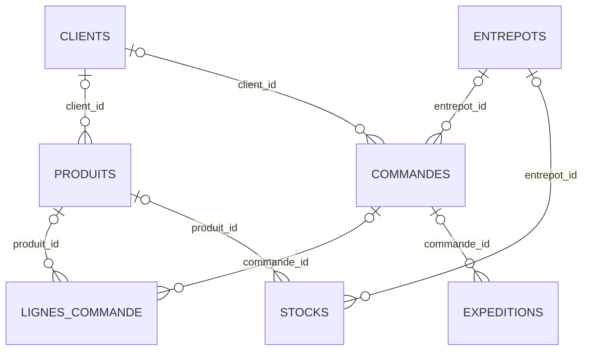

# Modèle de données MERISE — DATA CORE

## 1. Objectif

Ce document formalise le modèle de données de DATA CORE à partir du schéma
PostgreSQL existant. Il distingue les contraintes techniques effectivement
déclarées des règles métier qui restent à confirmer.

Le dictionnaire détaillé des colonnes est décrit dans `02_modele_donnees.md`.

## 2. Périmètre du modèle

La base contient 13 tables :

- Référentiel et exploitation FluxPro : `clients`, `entrepots`, `produits`,
  `commandes`, `lignes_commande`, `expeditions`, `stocks`.
- Consolidation des fichiers clients : `clients_consolides`.
- Historique : `historique_expeditions`.
- IoT : `iot_camera_comptage`, `iot_capteurs_temperature`,
  `iot_geoloc_flotte`, `iot_rfid_scans`.

## 3. MCD — entités identifiées

Les identifiants ci-dessous sont les identifiants techniques observés dans
le schéma SQL. Ils servent de base au modèle ; les identifiants métier et
les règles de gestion restent à valider.

| Entité | Identifiant |
|---|---|
| CLIENT | `id` |
| ENTREPOT | `id` |
| PRODUIT | `id` |
| COMMANDE | `id` |
| LIGNE_COMMANDE | `id` |
| EXPEDITION | `id` |
| STOCK | `id` |
| CLIENT_CONSOLIDE | `id` |
| HISTORIQUE_EXPEDITION | `id` |
| IOT_CAMERA_COMPTAGE | `id` |
| IOT_CAPTEUR_TEMPERATURE | `id` |
| IOT_GEOLOC_FLOTTE | `id` |
| IOT_RFID_SCAN | `scan_id` |

Les quatre entités IoT représentent des événements ou mesures collectés.
L'historique et les données clients consolidées sont actuellement stockés
sans clé étrangère vers les entités opérationnelles.

## 4. Relations déclarées dans PostgreSQL

Les relations suivantes correspondent aux huit clés étrangères présentes
dans la base.

| Entité porteuse de la FK | Attribut | Entité référencée |
|---|---|---|
| COMMANDE | `client_id` | CLIENT |
| COMMANDE | `entrepot_id` | ENTREPOT |
| EXPEDITION | `commande_id` | COMMANDE |
| LIGNE_COMMANDE | `commande_id` | COMMANDE |
| LIGNE_COMMANDE | `produit_id` | PRODUIT |
| PRODUIT | `client_id` | CLIENT |
| STOCK | `entrepot_id` | ENTREPOT |
| STOCK | `produit_id` | PRODUIT |

### Cardinalités techniques observées

Les huit colonnes de clé étrangère sont nullable dans le schéma actuel.
En conséquence, une ligne porteuse peut ne référencer aucun enregistrement
parent ou en référencer un seul. Un parent peut être référencé par zéro,
une ou plusieurs lignes enfants.

Ces cardinalités décrivent les contraintes techniques actuelles ; elles ne
suffisent pas à établir toutes les règles métier attendues.

## 5. Schéma relationnel — MLD

Les clés primaires et les références sont représentées ci-dessous.
Les autres attributs sont détaillés dans `02_modele_donnees.md`.

- `CLIENT` (**id**, code, nom, secteur)
- `ENTREPOT` (**id**, code, nom, ville, capacite_palettes)
- `PRODUIT` (**id**, sku, libelle, client_id FK, categorie, poids_kg, temperature_dirigee)
- `COMMANDE` (**id**, client_id FK, entrepot_id FK, date_commande, statut)
- `LIGNE_COMMANDE` (**id**, commande_id FK, produit_id FK, quantite)
- `EXPEDITION` (**id**, commande_id FK, tracking_number, transporteur, date_expedition, date_livraison_prevue, date_livraison_reelle, statut)
- `STOCK` (**id**, entrepot_id FK, produit_id FK, quantite, date_maj)
- `CLIENT_CONSOLIDE` (**id**, source, reference_commande, date_commande, reference_produit, designation_produit, quantite, entrepot_destination, poids_unitaire_g, chaine_froid_requise)
- `HISTORIQUE_EXPEDITION` (**id**, client, entrepot, categorie_produit, date_expedition, poids_kg, delai_livraison_jours, cout_transport_eur, statut)
- `IOT_CAMERA_COMPTAGE` (**id**, timestamp, entrepot, zone, nb_passages, sens)
- `IOT_CAPTEUR_TEMPERATURE` (**id**, timestamp, entrepot, zone, temperature_c, alerte)
- `IOT_GEOLOC_FLOTTE` (**id**, timestamp, vehicule_id, lat, lon, vitesse_kmh)
- `IOT_RFID_SCAN` (**scan_id**, timestamp, palette_id, entrepot, zone, produit_sku)

`FK` signifie clé étrangère. Les colonnes marquées FK sont celles qui
référencent les clés primaires listées dans la section 4.

## 6. Diagramme des relations existantes

Le diagramme représente uniquement les relations déclarées par les clés
étrangères. Il ne représente pas les liens métier potentiels entre les
données IoT, l'historique, les fichiers consolidés et les référentiels.

## 7. Points à valider avant de considérer le MCD comme définitif

- Confirmer les règles métier de rattachement des commandes aux clients et
  entrepôts.
- Confirmer si une commande doit obligatoirement avoir au moins une ligne.
- Confirmer si une commande peut avoir plusieurs expéditions.
- Définir les règles d'unicité métier pour les références de commandes,
  les SKU, les numéros de suivi et les stocks par entrepôt/produit.
- Décider si les données historiques et IoT doivent être reliées aux
  référentiels opérationnels.
- Documenter les règles de gestion et les éventuelles contraintes à ajouter.

## 8. Statut

Document préparatoire fondé sur le schéma PostgreSQL existant.
Les relations techniques sont vérifiées ; les règles métier et le MCD
conceptuel définitif restent à confirmer avec le cahier des charges.
